# Preset Gallery

One rendered sample from each preset. All content is fictional. Fonts, colors, icons and page size remain adjustable; see the [design choices](design-choices.md) for each direction.

## Clear Brief

Open rows, teal emphasis and a direct decision area. Preset: `clear-brief`. Sample: `evidence`.

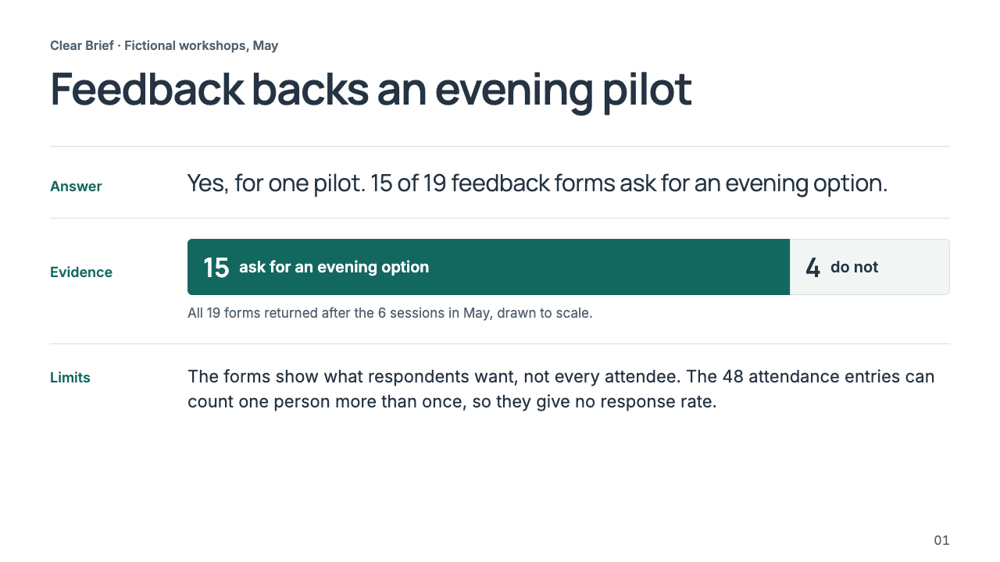

## Mono Brief

Short mono headings with spacious explanatory text. Preset: `mono-brief`. Sample: `evidence`.

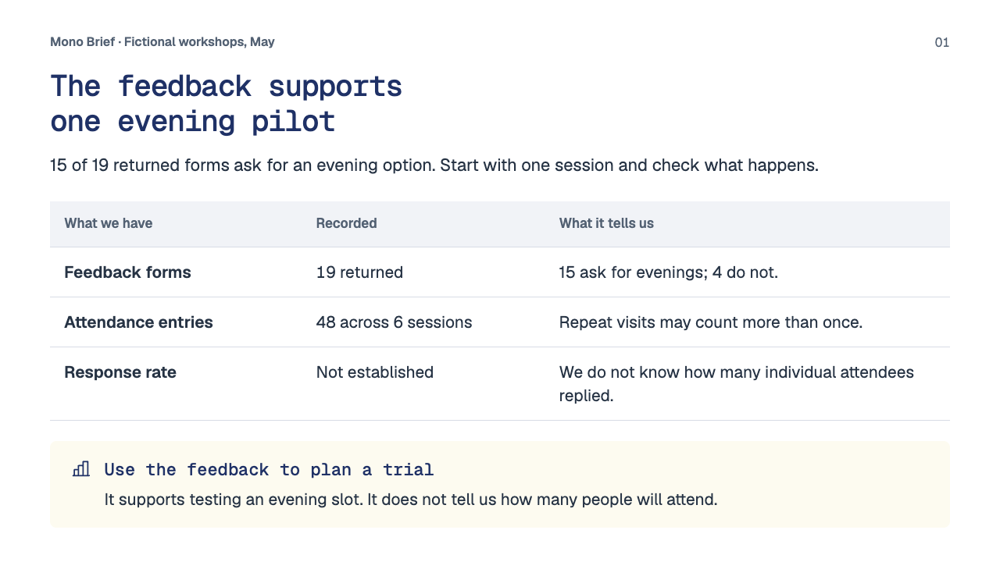

## Monochrome Grid

A strict black-and-white grid with inverted panels. Preset: `monochrome-grid`. Sample: `evidence`.

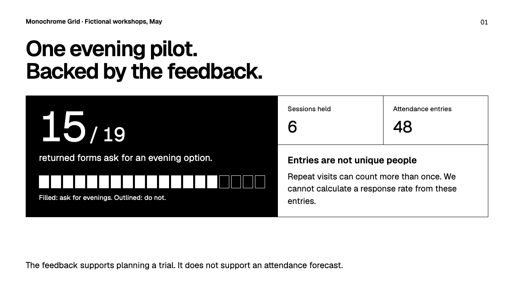

## Orange White

An open white canvas with selective orange emphasis. Preset: `orange-white`. Sample: `evidence`.

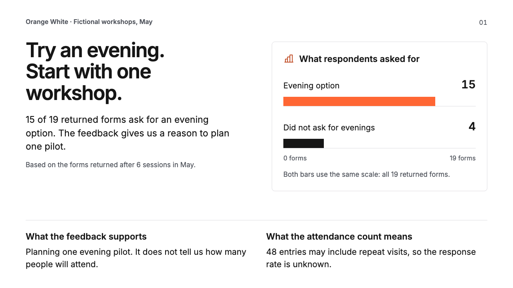

## Navy Orange

Navy evidence panels, orange highlights and white reading space. Preset: `navy-orange`. Sample: `evidence`.

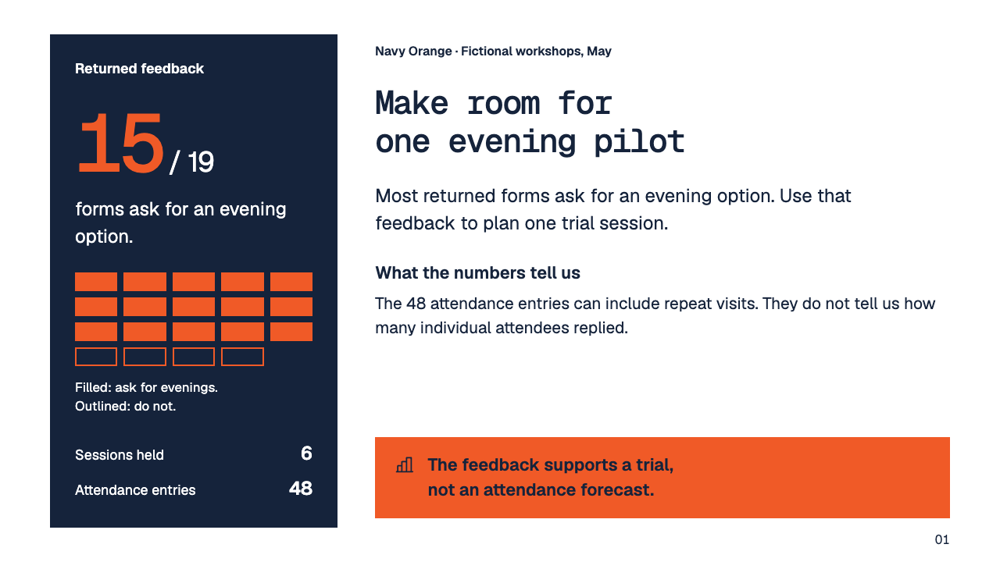

## Editorial Review

Clean type, geometric color blocks and direct evidence. Preset: `editorial-review`. Sample: `evidence`.

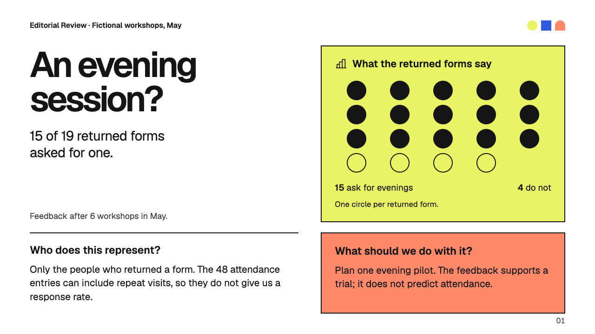

## Blueprint

Blueprint: structured inputs and a clear approval flow. Preset: `technical-notes`. Sample: `decision`.

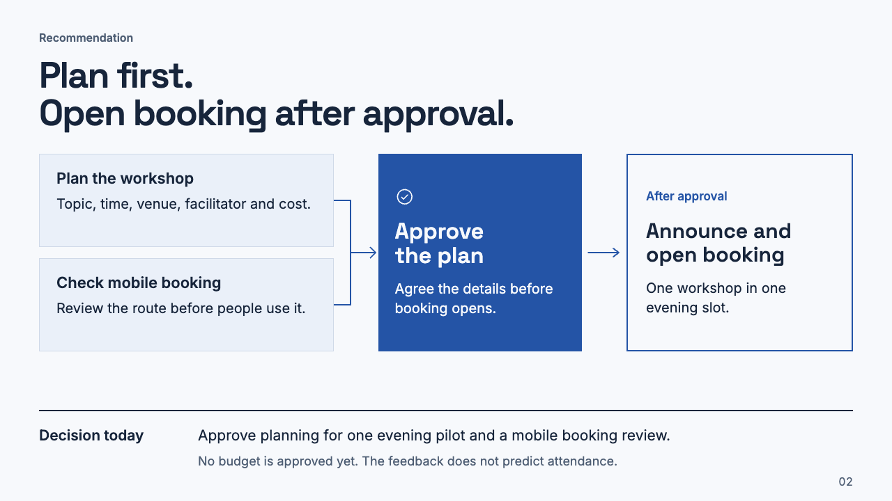

## Bold Story

Large type and strong color contrast for a focused argument. Preset: `bold-story`. Sample: `evidence`.

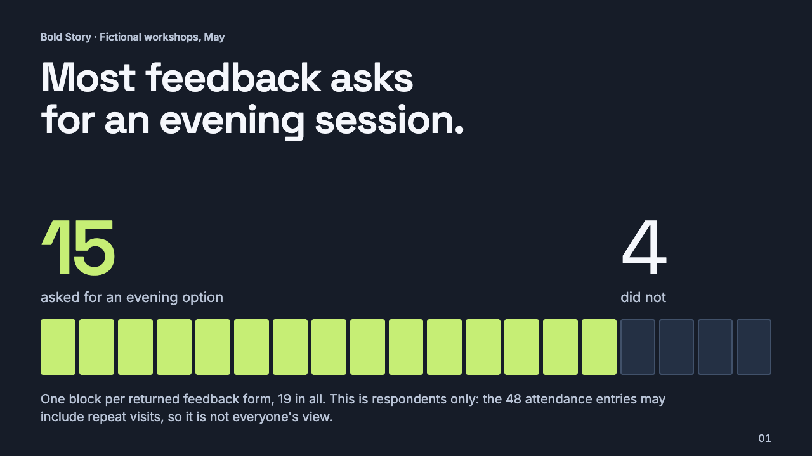

## Ledger

Ledger: mono figures and a labelled donut showing parts of a whole. Preset: `data-room`. Sample: `part-to-whole`.

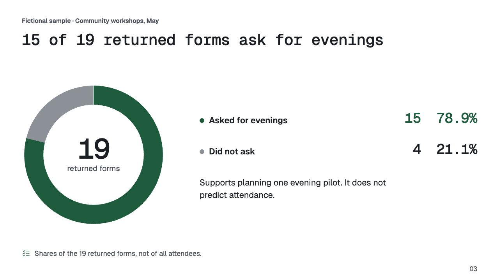

## Clay

Clay: warm surfaces and a centered sequence of steps. Preset: `warm-workshop`. Sample: `decision`.

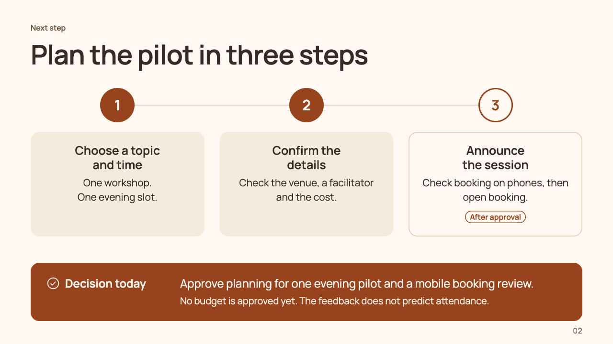

## Hard Reset

Hard Reset: heavy uppercase titles and acid-yellow evidence on black. Preset: `brutalist-cyberpunk`. Sample: `evidence`.

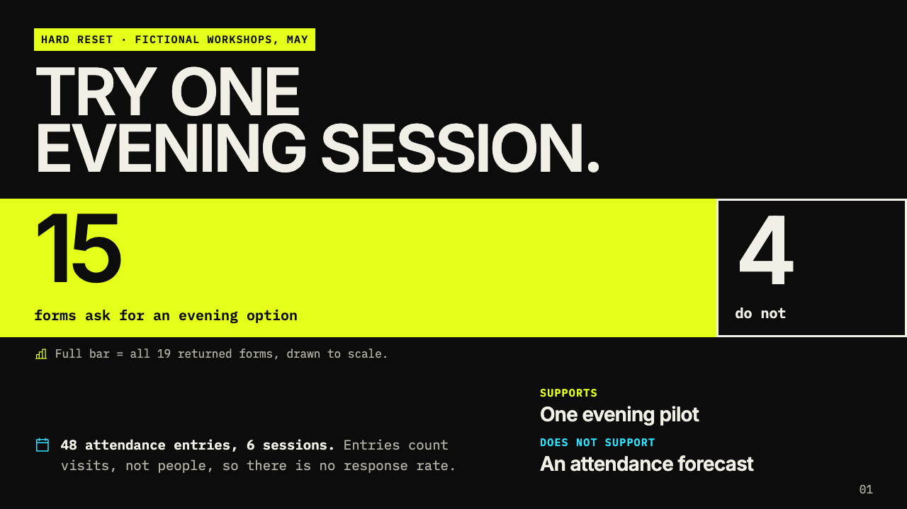

## Signal

Rounded panels and a segmented sequence in neutral gray and terracotta. Preset: `signal`. Sample: `planning`.

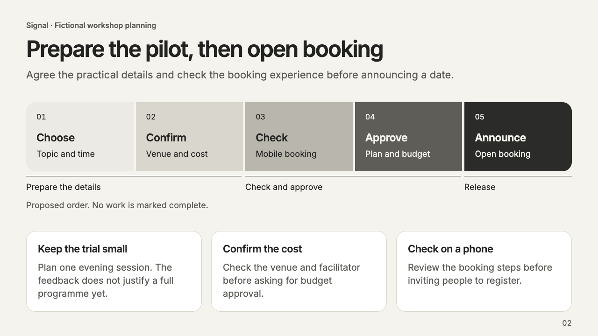

## View Every Sample

The preview generator produces all 27 pages as a standalone HTML file. Run from the repository root:

```sh
node skills/prep-that-slide/scripts/preview-presets.mjs --output /tmp/preset-catalogue.html
```

Open the result in a browser. For a single preset, add `--presets` followed by its ID. A renderer is needed to export PDF.

## Maintain The Screenshots

Render the bundled generator at its 1280 x 720 page size with print styles and device scale 1. Wait for the embedded fonts to load, then capture only the sample identified above through its `data-preset` and `data-example` attributes. Save as PNG, inspect the full page, and update this gallery when the corresponding design changes.

Include the fictional sample label. Keep browser chrome, private files and client content out of public previews. The bundled fonts and icons retain their individual licenses; see the [font manifest](../assets/fonts/manifest.json) and [Phosphor attribution](../assets/icons/phosphor/README.md).
